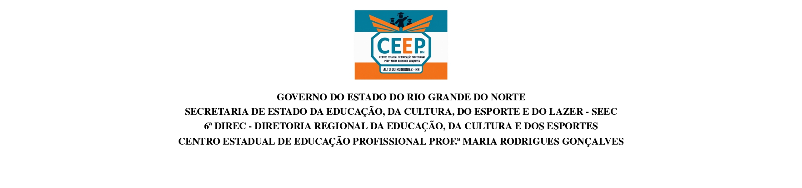
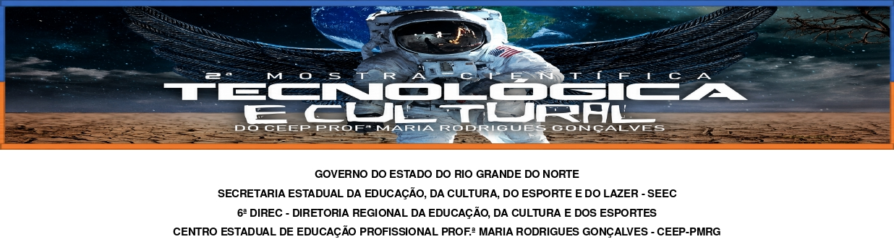

  
  

    

  <h1>Análise e Proposta de Adequação do Laboratório de Informática do CEEP-PMRG</h1>

  

    <strong>Trabalho de Conclusão de Curso (TCC) & Banner Científico</strong> 
    <em>ARAÚJO, A. F. G. D.; ALVES, D. S. G.; PIMENTEL, F. P.; ARAÚJO, F. L. D.; CARDOSO, J. V.</em>
    <em>Versão Retificada e Consolidada (2026)</em>
  

  
   
  
  

---

## 📖 Sobre o Projeto

Este repositório consolida o projeto de **Trabalho de Conclusão de Curso (TCC)** e o respectivo **Banner (Pôster Científico para Amostra Científica)**. O trabalho retrata a importância da adequação e do uso dos laboratórios de informática para as instituições, pois é necessário qe estes ambientes sejam bem estruturados de acordo com o que é previsto pelas normas.

> **Nota da Versão (2026):** Esta é a versão retificada do trabalho original apresentado e entregue à instituição em 2022. O conteúdo textual e os artefatos em LaTeX refletem as correções metodológicas, conceituais e normativas finalizadas e consolidadas em 2026.

---

## 📦 Publicações & Rastreabilidade Documental

A versão de 2022 representa a entrega histórica institucional, enquanto a versão retificada de 2026 é a publicação oficial indexada via **Zenodo** com atribuição de DOI para citação acadêmica.

| Documento | Versão Entregue à Instituição (2022) | Versão Retificada e Publicada (Zenodo - 2026) | DOI / Link Permanente |
| :--- | :--- | :--- | :--- |
| **Monografia (TCC)** | [`TCC Original 2022`](docs/pdf/origin/TCC_2022_ANALISE_E_PROPOSTA_DE_ADEQUACAO_DO_LABORATORIO_DE_INFORMATICA_DO_CEEP-MRG.pdf) | [`TCC Retificada 2026`](docs/pdf/rectified/araujo-a-f-g_alves-d-s-g_pimentel-f-p_tcc.pdf) |  |
| **Banner (Pôster)** | [`Banner Original 2022`](docs/pdf/origin/TCC_2022_BANNER_ANALISE_E_PROPOSTA_DE_ADEQUACAO_DO_LABORATORIO_DE_INFORMATICA_DO_CEEP-MRG.pdf) | [`Banner Retificado 2026`](docs/pdf/rectified/araujo-a-f-g_alves-d-s-g_pimentel-f-p_banner-tcc_2022.pdf) |  |

---

## 🏛️ Localização dos Documentos Institucionais

Como a versão retificada de 2026 não substitui o acervo físico/digital protocolado na instituição em 2022, este repositório serve como uma ponte de consulta.

* **Versão Oficial da Instituição (2022):** Entregue em meio físico junto à Diretoria do Centro Estadual de Educação Profissional Professora Maria Rodrigues Gonçalves. *(Nota: Caso a instituição publique um repositório institucional no futuro, o link permanente será atualizado nesta seção).*
* **Versão Consolidada e Indexada (2026):** Disponível para download público e citação científica direta nos links do Zenodo na tabela acima.

---

## 📄 Código-Fonte em LaTeX (`.tex`)

Todo o texto, estrutura de capítulos, formatação ABNT e layout do poster científico foram desenvolvidos utilizando **LaTeX**. Os arquivos-fonte da versão retificada estão organizados no repositório para consulta, auditoria acadêmica ou recompilação:

* **TCC Retificado:** Localizado em `docs/pdf/rectified/view/tcc/`. Contém o arquivo principal `araujo-a-f-g_alves-d-s-g_pimentel-f-p_tcc.tex`, assets, images e figures, divisões de capítulos e a base de dados de referências crie `references.bib`.
* **Banner Retificado:** Localizado em `docs/pdf/rectified/view/banner/`. Contém o arquivo `tcc-araujo-a-f-g_alves-d-s-g_pimentel-f-p_banner-tcc_2022.tex`, assets como images e figures, e a base de dados de referências crie `references.bib`.

---

## 🛠️ Ferramentas & Tecnologias Utilizadas

### **Editoria Acadêmica & Publicação**
* **Editor/Compilador Textual:** LaTeX (abnTeX2 / pdfLaTeX / XeLaTeX)
* **Gerenciador de Referências:** BibTeX / BibLaTeX (`.bib`)
* **Preservação Digital:** Zenodo (Atribuição de DOI para a versão de 2026)
* **Controle de Versão:** Git & GitHub